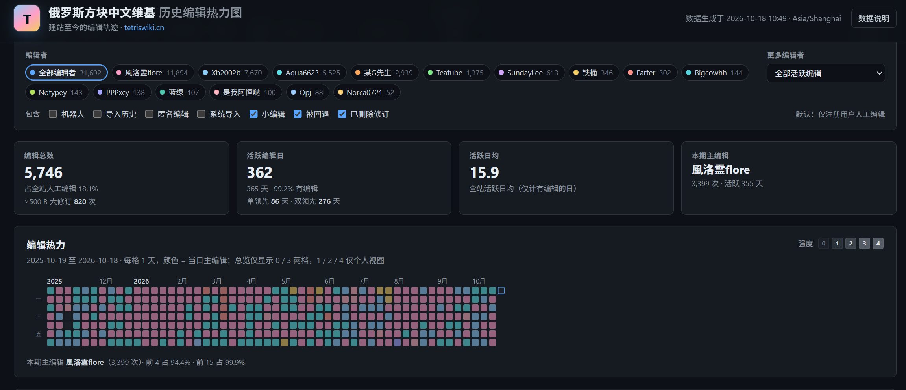

# 俄罗斯方块中文维基 历史编辑热力图

**欢迎浏览收藏[俄罗斯方块中文维基](http://tetriswiki.cn)！**



以 GitHub 编辑热力图为灵感，部署于本地的编辑热力图

背景：站点迁移两周年之际，想 vibe 一个编辑热力图，看看不同时期的活跃编辑。

## 功能

- 本地静态网页，无须重新抓取 API 即可查看
- 支持自定义查看时间范围，默认最近一年（当前快照为 251019-261018）
- 支持总览/查看具体编者热力图
- 主要数据：编辑总数、活跃日、活跃日均编辑、周期最活跃编辑，醒目显示
- 五级热力，同时兼顾用户日均编辑和当日活跃排行，最高级热力还有金色边框特效（仅个人视图）
- 编辑者独属配色，可在 [调色板 JS 文件](js/palette.js) 调整
- 详细数据说明

## 限制

依然没有搞清楚详细数据，AI 给出了自己的解释，见 [EQUATION.md](EQUATION.md)。

## 食用

大概是开包即食。下载/抓取后打开 index.html 即可查看。

若浏览器对本地文件有限制，可用本地 HTTP 服务：

```bash
python -m http.server 8000
```

## 更新数据

需要 Python 3.10+，并在项目根目录运行：

```bash
# 全量重抓当前修订 + 已删除修订，然后重建前端数据
python scripts/fetch_edits.py --fresh

# 已有 data/raw 数据时，重建 data/meta.js、data/edits.js 与 data/summary.json
# 注意：仍会联网读取 statistics / siteinfo / allusers 元数据
python scripts/fetch_edits.py --build-only

# 只抓取，不重建
python scripts/fetch_edits.py --fetch-only

# 限制本轮抓取的页数，便于测试或分批续抓
python scripts/fetch_edits.py --max-pages 40 --fetch-only
```

抓取脚本已加 maxlag 与 1 秒延迟；**请勿短时间反复执行** `--fresh`。

## 数据口径与已知限制

- 数据来自 MediaWiki `allrevisions`（现存修订）和 `alldeletedrevisions`（已删除修订），按 revid 去重；时间统一为 Asia/Shanghai（UTC+8）。
- 默认筛选为“仅注册用户人工编辑”，即排除机器人、导入历史、匿名和系统账号；小编辑、被回退、已删除修订默认包含。
- 热力为 0–4 五档：总览只显示 0 / 3；个人视图显示完整 0–4；3、4 档同色，4 档另加 1px 金色外框。
- 个人视图的日期范围默认取「注册日与首次编辑日中较早者 → 末次编辑」。2024 年站点迁移重置了旧站账号的注册日，因此取较早者才能保留旧站历史。
- 参数设置 / `allusers` 显示的编辑数是 MediaWiki 的 `user_editcount` 缓存值，与「现存贡献 + 已删除贡献」不保证相等。前者可能保留一部分旧站已删除修订，也可能漏掉另一部分。详见 [EQUATION.md](EQUATION.md)。
- 删除贡献页的计数与我们通过 `alldeletedrevisions` 抓到的 archive 修订可能相差少量记录（本次快照中为 1–3 条），以 API 原始 archive 为准。
- `statistics` 总编辑数 40,582 与可访问修订 38,777 相差 1,805，差额来自隐藏、删除后不可见或权限不可读的修订。
- 导入历史账号（`imported>…`、`>…`）的时间戳是导入时间；带真实用户名的旧 wiki 历史保留原始时间戳（最早可到 2006 年）。
- 已删除修订的编辑摘要通常无法读取，日详情中只保留时间、页面、大小变化和标记。
- 页面是静态快照，不会自动更新；需要最新数据时重新运行抓取脚本。

## 著作权

- 代码许可证待定
- Wiki 文本与数据：按俄罗斯方块中文维基相关规定处理，详见[站点的著作权说明页面](http://tetriswiki.cn/index.php?curid=5595)

## 致谢

Powered by Cline using deepseek-flash, based on tetriswiki.cn and made by love.
